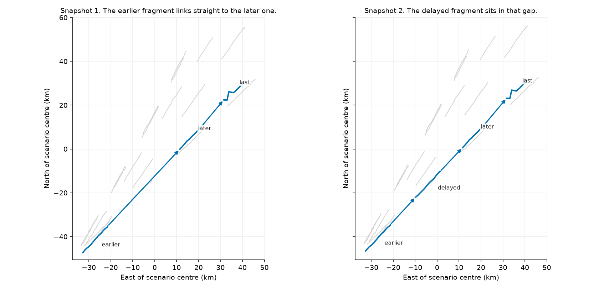
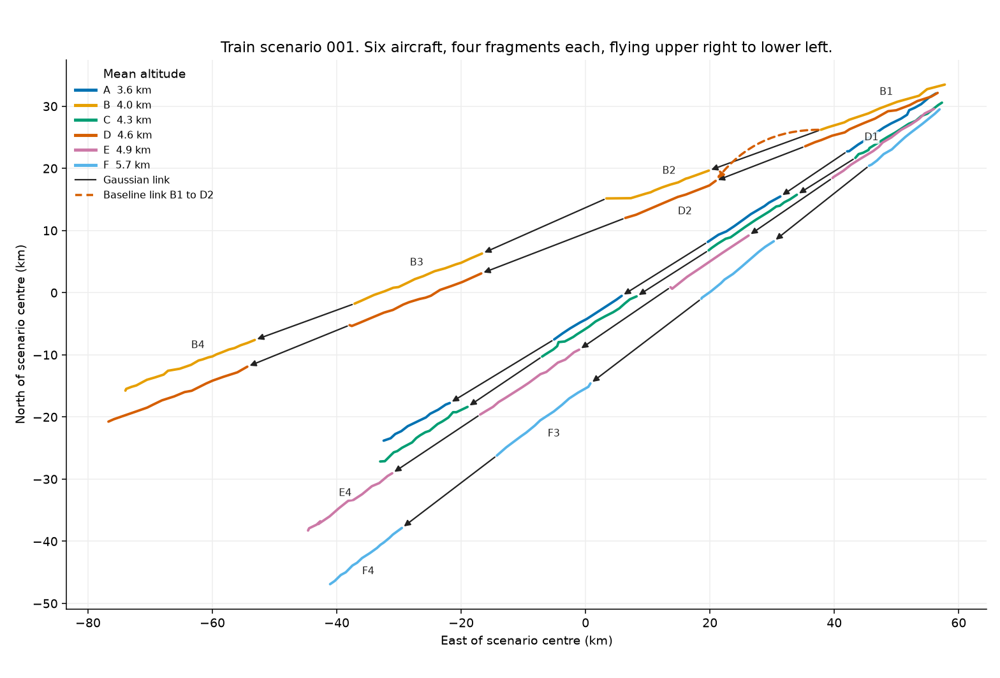

# aircraft-track-association

Decide which disconnected aircraft movement fragments (tracklets) belong together.
For each tracklet the system either accepts one successor (the next fragment of the same aircraft) or leaves it unresolved, and explains why.

Three approaches are implemented and compared:

- **Baseline:** a constant-velocity projection rule with a fixed 5% tolerance.
- **Gaussian continuity model:** each tracklet is summarised as position, altitude and velocity Gaussians, candidate links are scored with seven continuity costs, and a global assignment picks a consistent set of links.
- **Learned:** a gradient-boosted classifier scores each candidate pair, then greedy selection keeps a link only when the score and its margin clear a threshold.
  The author chose a gradient-boosted classifier as the strategy, and Claude Code built and trained the rest.

The baseline has one fixed setting, a 5% tolerance given in advance and not tuned.
The Gaussian model's weights were tuned by random search on training data only.
All approaches are fit on training data only, with no leakage.

## Results

Counts are pooled over every scenario in a partition, and precision and recall are computed once from those totals.
A scenario with more links therefore counts for more than a smaller one.
"Wrong" is an accepted link that is not the labelled successor.
"Unresolved" is a labelled link whose source got no successor.

| Approach | Partition | Correct / true links | Wrong | Unresolved | Precision | Recall |
| --- | --- | ---: | ---: | ---: | ---: | ---: |
| Baseline | Train (80) | 285 / 1364 | 553 | 526 | 0.340 | 0.209 |
| Baseline | Validation (20) | 68 / 335 | 139 | 128 | 0.329 | 0.203 |
| Baseline | Test (20) | 64 / 339 | 135 | 140 | 0.322 | 0.189 |
| Gaussian | Train (80) | 1337 / 1364 | 12 | 15 | 0.991 | 0.980 |
| Gaussian | Validation (20) | 331 / 335 | 1 | 3 | 0.997 | 0.988 |
| Gaussian | Test (20) | 333 / 339 | 4 | 2 | 0.988 | 0.982 |
| Learned | Train (80) | 1364 / 1364 | 0 | 0 | 1.000 | 1.000 |
| Learned | Validation (20) | 327 / 335 | 0 | 8 | 1.000 | 0.976 |
| Learned | Test (20) | 327 / 339 | 0 | 12 | 1.000 | 0.965 |

The Gaussian model's settings were frozen before the test labels were first read, and nothing was changed after.
The learned approach was developed on train and validation only and then run on test once.
The test labels had already been read, during earlier work on the baseline and the Gaussian model, before this approach was added.
Its operating point maximises validation recall among settings with precision at least 0.95: minimum score 0.05 and minimum margin 0.20.
On that validation sweep the permissive setting (margin 0) and the conservative setting (mutual best) are both precision 0.997 and recall 0.973, with one wrong link; the operating margin removes that wrong link.
Tracklets without a labelled successor were never given one by the Gaussian model in any partition.
Candidate generation keeps every pair whose target starts after its source ends, so every labelled successor is a candidate.
That candidate recall is 100% for all three approaches.
Full tuning history, error analysis and the trade-off between wrong and unresolved links are in [REPORT.md](REPORT.md).

The baseline's precision stays between 0.25 and 0.36 at any tolerance on validation, so tightening it cannot make it trustworthy:

| Baseline tolerance | Accepted | Correct | Wrong | Unresolved | Precision | Recall |
| ---: | ---: | ---: | ---: | ---: | ---: | ---: |
| 0.5% | 56 | 16 | 40 | 279 | 0.286 | 0.048 |
| 1% | 93 | 23 | 70 | 242 | 0.247 | 0.069 |
| 2% | 137 | 36 | 101 | 198 | 0.263 | 0.107 |
| 5% (used) | 207 | 68 | 139 | 128 | 0.329 | 0.203 |
| 10% | 247 | 89 | 158 | 88 | 0.360 | 0.266 |

It checks speed only: any tracklet roughly the right distance away passes, whatever its direction, so with six aircraft per scenario it often picks the wrong one.

### Stress test

Each tracklet is thinned to a random 50% or 25% of its reports, with at least 3 kept.
Supporting records of removed reports are dropped.
The baseline and the Gaussian model are then rerun with no retuning (`stress` command; details in REPORT.md).
At 25%, averaged over seeds 0-4 on test, the Gaussian model makes 7.6 wrong and 10.4 unresolved links with `train_hand_tuned` (4 and 2 unthinned) and 4.8 wrong and 2.6 unresolved with `validation_search` (2 and 0 unthinned).
Precision stays above 0.97 for both.
The baseline improves slightly when thinned (test precision 0.322 to 0.387) but stays far below the Gaussian model.

### Additional evidence (staged demo)

Snapshot 1 and snapshot 2 are analysed independently with the same settings.
Saved results are in `results/staged_demo/`.
Snapshot 2 adds one delayed fragment whose observation times fall inside a gap that snapshot 1 already bridges.
Call the fragment before that gap the earlier fragment, the new one the delayed fragment, and the fragment after the gap the later fragment.
One more fragment of the same aircraft, the last fragment, follows the later one.



Grey tracks are the other aircraft in the snapshot.
The blue track is the aircraft described here, in kilometres east and north of the snapshot centre, on the same local projection the model uses.

- Gaussian model: in snapshot 1 the earlier fragment is linked straight to the later fragment (cost 0.350, gap 346 s).
  In snapshot 2 that link is replaced by earlier to delayed (cost 0.175, gap 122 s) and delayed to later (cost 0.116, gap 106 s).
  This is the same aircraft with a newly available intermediate fragment, not a change of identity.
  Both snapshots match their own labels exactly (17/17 and 18/18).
- Baseline: leaves the new fragment unlinked and changes nothing else.
  It gets 2 of 17 and 2 of 18 links right.

## How it works

Shared preparation, used by all three approaches (`io.py`, `track.py`):

1. **Validate.** Required fields present, IDs non-empty strings, `observed_at` and `received_at` ISO 8601 in UTC, latitude and longitude numeric and in range, `altitude_ft` numeric or null, `attributes` an object.
   Violations are rejected with a message naming the record.
2. **Deduplicate.** Records with the same ID and equal parsed JSON are kept once; different content under one ID is rejected.
   A missing field and an explicit null count as different, as the clarifications specify.
   The same rules apply to supporting records keyed on `record_id`.
3. **Receipt cutoff.** When a cutoff is given, records received after it are left out, so a snapshot only sees evidence released by then.
4. **Project.** Latitude/longitude are projected to a local azimuthal equidistant plane centred on the scenario, in metres.
   EPSG:3857 was not used because it inflates distances by about 22% at these latitudes.
5. **Altitude.** `altitude_ft * 0.3048` when reported, else supporting `a1` (see below), else the tracklet's mean altitude.
6. **Order and near-duplicates.** Reports are sorted by `observed_at` (observation ID breaks ties).
   A report from the same feed within 0.5 s and 50 m of the previous kept one is dropped.
7. **Velocity.** Each velocity sample uses two reports at least 10 s apart.
   Reports can be less than a second apart.
   About 200 m of position noise over a gap that short would make the speed wrong by hundreds of metres per second.

**Baseline** (`baseline.py`): for each candidate pair, compare the horizontal displacement from the source's last report to the target's first report with the source's last speed times the time gap.
Score is `|displacement / projected - 1|`.
Pairs within 5% are acceptable and are taken greedily, best score first, skipping any source that already has a successor or target that already has a predecessor.

**Gaussian continuity model** (`associate.py`, settings in `weights.py`): each tracklet gets a horizontal position Gaussian, an altitude Gaussian and a 3D velocity Gaussian, plus start and end states from line fits over its first and last 6 reports.
Each candidate pair is scored by a weighted sum of seven costs:

| Term | Meaning |
| --- | --- |
| plausibility | $\lvert\ln(d_{\mathrm{actual}} / d_{\mathrm{projected}})\rvert$, where $d_{\mathrm{actual}}$ is the distance from the source's end to the target's start and $d_{\mathrm{projected}}$ is the source's end speed times the gap |
| heading | is the target ahead of the source along its direction of travel |
| vel_cos | are both tracklets flying the same way |
| vel_w2 | Wasserstein-2 distance between velocity Gaussians |
| pos_w2 | Wasserstein-2 distance between horizontal position Gaussians |
| alt_w2 | Wasserstein-2 distance between altitude Gaussians |
| dt | gap length, so a link that skips an intermediate tracklet costs more |

A Hungarian assignment over the cost matrix, extended with a "no match" option per source at cost 1.0, selects links so every tracklet has at most one successor and one predecessor.
A competing candidate can lose even when it is a source's cheapest option, if giving it to another source lowers the total cost; the decision reason says so.

**Learned** (`learned.py`, saved trees in `artifacts/learned.joblib`): each candidate pair is the same strictly-later pair the other approaches consider.
Features are the kinematic gap, straight-line distance, projected miss and its along-track and cross-track parts, miss over a gap allowance fit on train true links, end and start speeds and their difference, heading change, implied straight speed, counts of earlier candidates and earlier plausible candidates, altitude difference, reported speed and heading differences, reported speed versus kinematic speed, whether the reference codes match (placeholder `C0FFEE` ignored), and the low-quality report fraction.
They do not include the Gaussian cost terms or the baseline ratio.
A `HistGradientBoostingClassifier` (learning rate 0.08, 200 iterations, depth 4, minimum 20 samples per leaf, L2 0.1, seed 42) is fit on train pairs only, with class weights balancing the 1,364 true links against the other pairs.
The score is that model's predicted chance the candidate is the immediate next tracklet.
Greedy best-first selection then accepts a pair only when the score is at least 0.05 and leads the next remaining candidate by at least 0.20; otherwise the tracklet stays unresolved and a worse candidate is not taken in its place.
One tracklet has at most one successor and one predecessor.

**Scores.** Baseline and Gaussian scores are costs: lower is better and 0 is a perfect fit.
The learned score is a predicted chance: higher is better.
None of the scores are calibrated probabilities.

**Constraints.** A target must start strictly after its source ends, so accepted links can never form a cycle.
Results do not depend on input order or on identical duplicates; tests check both.

## Signals used and excluded

| Signal | Use | Basis |
| --- | --- | --- |
| `observed_at`, `latitude`, `longitude` | used | documented core fields |
| `altitude_ft` | used, converted to metres | documented core field; missing in about 23% of reports |
| `received_at` | used only to apply receipt cutoffs | documented; it says when evidence was available, not where the aircraft was |
| supporting `a1` | used to fill missing altitude | undocumented; inferred as altitude in metres, see below |
| `source` | unused | restricts near-duplicate removal to the same feed |
| observation `attributes` | unused by the baseline and the Gaussian model | see the per-feed table below; interpretations are inferred from training data, not documented, and the learned model uses a reference-code match |
| supporting `spd`, `b4`, `rx` | unused | uncorrelated with altitude (correlation near 0); not compared with speed or heading; `b4` does not change `a1`'s accuracy |
| IDs and file order | used | grouping, joining and tie-breaking only |

Observation attributes, checked against speed and heading computed from each tracklet's positions on the 80 train scenarios:

| Feed | Field | Likely meaning | Evidence | Status |
| --- | --- | --- | --- | --- |
| feed-a | `spd` | speed in knots | median ratio to computed speed in m/s is 1.946 (1 m/s = 1.944 kn), as the source notes say; 94% within 10% after conversion, 3.9% off by more than half | unused |
| feed-b | `spd` | speed in m/s | median ratio 1.002; 93% within 10%, 5.8% off by more than half | unused |
| feed-c | `v` | speed in km/h | median ratio 3.602 (1 m/s = 3.6 km/h); 94% within 10%, 2.5% off by more than half | unused |
| feed-a | `crs` | heading in degrees | median difference from computed heading 1.8 degrees | unused |
| feed-b | `c2` | heading in degrees | median difference 1.7 degrees | unused |
| feed-c | `hdg` | heading in degrees | median difference 1.8 degrees | unused |
| feed-a, feed-b | `ref` | reported aircraft identifier | constant within every tracklet; shared by 41% of true successor pairs (with `tag`) but also by 5.5% of other candidate pairs | unused except as a learned reference-code match |
| feed-c | `tag` | reported aircraft identifier | as `ref` | unused except as a learned reference-code match |
| all | `q` | quality code, meaning unknown | integers 0-3 in feed-a, strings "0"-"3" in feed-b, H/M/L in feed-c; one value in each feed is rare (under 1%) | unused |
| all | `node` | ingest worker (`worker-N`) | transport diagnostic, not aircraft behaviour | unused |
| all | `r7` | unknown | uniform between -10 and 10, uncorrelated with speed or heading | unused |

The speed and heading fields are plausible but redundant: the Gaussian model already measures speed and direction from positions, and the reported values include gross errors in 2.5-5.8% of reports.
The identifiers change between fragments of the same aircraft more often than not and are sometimes shared by different aircraft, so they are not reliable identity evidence on their own.
A reference-code match, with the placeholder C0FFEE ignored, is one feature of the learned model.
The Gaussian model and the baseline leave these fields out, so those two approaches stay on documented fields plus `a1`.

`a1` is read as altitude in metres because, on the 10,194 train observations that also report `altitude_ft`, it agrees with `altitude_ft * 0.3048` with correlation 0.999, median ratio 1.000 and at most 162 m difference.
It is null in about 12% of supporting records and fills 54% of missing altitudes.
This is an inference from data, not a documented meaning.

Supporting records are joined to observations only by `observation_id`, as documented.
That join is a property of the data contract, not an assumption of the model.

## Assumptions

- Each scenario is independent; links never cross scenarios.
- Motion is smooth and subsonic, so a local planar projection and straight-line extrapolation over gaps of a few minutes are adequate, as the data contract allows.
- A tracklet needs at least two reports at distinct times; otherwise it is rejected.
- Each observation has at most one supporting altitude; two different values for one observation are rejected rather than resolved silently.

## Known limitations

Results are on synthetic data with simplified motion and sources.
They are not evidence of real-world accuracy.

### Learned approach

The learned score is not a calibrated probability.
The learned model is deterministic given its saved artifact.
The service loads `artifacts/learned.joblib` at startup and does not retrain.
`GET /health` reports that artifact and its version `learned-1.0.0`.

### Gaussian approach

The only randomness elsewhere is the Gaussian weight search, and it is seeded (`--seed 0`).
Two weight sets exist.
`train_hand_tuned` is the default.
`validation_search` is the random search on training data only, 2000 trials, objective 2 x wrong + unresolved, ties broken by margin.
Details are in REPORT.md.
The second makes fewer errors on train and test.
32 trials reached zero errors on validation with widely different weights, so validation alone does not pin the weights down.
Scales, the velocity window and the no-match cost were set by hand.
Lowering the no-match cost removes few wrong links per unresolved link it adds.
Most remaining wrong links are confident swaps between nearby aircraft.
Abstaining when the best and second-best candidates are close would target them better.
The `dt` penalty grows with the absolute gap, so it cannot be raised to stop skipped tracklets without also penalising long true gaps.

### Baseline

The baseline checks speed only, so a tracklet at roughly the right distance can be accepted even when it belongs to another aircraft.

## Demonstrations (train scenario_001)

Scenario_001 has 24 tracklets: six aircraft, each seen in four fragments about two minutes long with gaps of 80-140 s.
The figure labels aircraft A to F from lowest mean altitude to highest, and numbers each aircraft's fragments 1 to 4 from earliest to latest.
Those altitudes are about 3.6, 4.0, 4.3, 4.6, 4.9 and 5.7 km.
With the default weights the Gaussian model gets all 18 links right.
The baseline gets 6 right and 6 wrong, and disagrees with the Gaussian model on 12 of 24 tracklets.
In the interface, choose `train / scenario_001` and click a tracklet to see the details below.



Every fragment is drawn, in kilometres east and north of the scenario centre, on the same local azimuthal equidistant plane the model uses.
Labels mark the fragments this section discusses.
Black arrows are the links the Gaussian model accepts.
The dashed arrow is the baseline's link from B1 to D2.
All six aircraft travel from the upper right toward the lower left.

**A clear continuation.** F3 to F4 is accepted with cost 0.136: gap 117 s, plausibility 0.009 (distance within 1% of the projection), altitude difference 10 m, target almost exactly on the source's line of travel.
The next candidate, E4, costs 4.755, mainly because it sits 865 m lower and off the line of travel.
The baseline leaves F3 unresolved: its best candidate within 5% is E4, which another source had already taken with a closer ratio.

**Competing plausible continuations.** For B1, three candidates have nearly identical plausibility (0.015-0.016) and all lie along its line of travel.
The labelled successor B2 (cost 0.216, gap 111 s) wins over B3 (0.339, gap 334 s) and B4 (0.545, gap 559 s).
B3 and B4 are the same aircraft's next two fragments after B2.
The gap penalty is what separates them: accepting B3 would skip an available intermediate tracklet, which counts as wrong.
The baseline accepts D2 for B1 instead (ratio 0.980).
D2 belongs to another aircraft.
It is the labelled successor of D1.
The baseline checks speed, not direction, so it cannot tell D2 apart from B2.

**Unresolved tracklets.** The six tracklets in the last two-minute window (A4, B4, C4, D4, E4 and F4) are left unresolved by both approaches, with the reason "no tracklet starts after this one ends".
The labels agree: none of them has a successor in this scenario.

**A decision revised by new evidence.** See [Additional evidence](#additional-evidence-staged-demo) above.

**Reordered and duplicated input.** Shuffling scenario_001's 322 observation rows, adding 25 duplicated rows and reversing the supporting records gives identical decisions and the same input hash (`9b7c1b59c4ae...`).
`tests/test_pipeline.py` checks the same property on validation scenario_001.

## From synthetic to real data

This dataset makes association easier than real traffic in several ways:

- Motion is smooth and subsonic with no takeoffs, landings, holding patterns or sharp turns, so straight-line extrapolation across a two-minute gap works almost perfectly.
- Every scenario has exactly six aircraft with fragments in regular two-minute windows, so the structure of gaps is uniform.
- Same-aircraft fragments never overlap, which removes a whole class of candidates.
- Position noise is moderate and roughly constant; real sensors vary by source, range and geometry.
- Labels are complete and correct.

Before trusting this on real observations, I would check:

- how extrapolation error grows with gap length and manoeuvres, and whether the gap gate and costs need a motion model that allows turns,
- per-source noise and bias, including timestamp offsets between feeds,
- how often real reported identifiers (`ref`, `tag`) persist across gaps and how often they collide, since they could be strong evidence there,
- precision at the operating point on a labelled sample from the target airspace, with wrong links reviewed by hand,
- behaviour under dense traffic, where many more candidates compete for each tracklet.

## Setup and commands

Requires Python 3.12 and [uv](https://docs.astral.sh/uv/).
Dependencies are pinned in `uv.lock`.

```bash
uv sync                                   # create the environment
uv run pytest                             # run the tests
uv run ruff check . && uv run ruff format --check .   # lint
```

Evaluate against labels (one directory prints per-link diagnostics; several print per-scenario lines and totals):

```bash
uv run python -m aircraft_track_association evaluate candidate-packet/data/train/scenario_*
uv run python -m aircraft_track_association evaluate candidate-packet/data/validation/scenario_*
uv run python -m aircraft_track_association evaluate candidate-packet/data/test/scenario_*
uv run python -m aircraft_track_association evaluate candidate-packet/data/test/scenario_014 --approach gaussian
uv run python -m aircraft_track_association evaluate candidate-packet/data/test/scenario_* --approach learned
```

Fit the learned model on train and choose its threshold on validation (this does not read test), writing `artifacts/learned.joblib`:

```bash
uv run python -m aircraft_track_association train candidate-packet/data/train/scenario_* --validation candidate-packet/data/validation/scenario_*
```

Stress test (thin each tracklet to 25% of its reports, seeded, no retuning):

```bash
uv run python -m aircraft_track_association stress candidate-packet/data/test/scenario_* --keep 0.25 --seed 0
```

Search Gaussian-model weights on validation (prints the best trials; does not edit `weights.py`), and evaluate with a named weight set:

```bash
uv run python -m aircraft_track_association tune candidate-packet/data/validation/scenario_* --trials 2000 --seed 0
ATA_WEIGHT_SET=validation_search uv run python -m aircraft_track_association evaluate candidate-packet/data/test/scenario_* --approach gaussian
```

Run association on one snapshot without labels and save the result (this is how `results/staged_demo/` was produced):

```bash
uv run python -m aircraft_track_association analyze candidate-packet/data/staged_demo/snapshot_1 -o results/staged_demo/snapshot_1.json
uv run python -m aircraft_track_association analyze candidate-packet/data/staged_demo/snapshot_2 -o results/staged_demo/snapshot_2.json
```

Regenerate the demonstration figures:

```bash
uv run python scripts/plot_demonstrations.py
```

Start the service and web interface, then open http://127.0.0.1:8000:

```bash
uv run python -m aircraft_track_association serve
```

The interface lets a reviewer pick a scenario and run all three approaches, see tracklets and accepted links on a longitude/latitude plot, compare decisions against the labels, inspect each tracklet's ranked candidates, measurements, decision reason and original reports, and compare the two staged snapshots.

## API

All errors are JSON, `{"error": {"code": str, "message": str}}`: 404 `not_found`, 422 `invalid_request` (malformed body) or `invalid_input` (records that break the data contract), 500 `internal_error`.

`GET /health` returns `status`, `model_version`, `approaches` and `config_sha256`.

`POST /tracklets/associate` takes raw records exactly as they appear in the JSONL files:

```json
{
  "snapshot_id": "optional string",
  "receipt_cutoff": "optional ISO 8601 UTC timestamp",
  "observations": [{"observation_id": "...", "tracklet_id": "...", "observed_at": "...", "...": "..."}],
  "supporting": [{"record_id": "...", "observation_id": "...", "...": "..."}]
}
```

It returns:

```json
{
  "snapshot_id": "...", "receipt_cutoff": "...",
  "input_sha256": "hash of the deduplicated, ID-sorted inputs",
  "model_version": "0.1.0", "config_sha256": "...", "config": {"...": "every decision setting"},
  "counts": {"observation_rows": 0, "unique_observations": 0, "tracklets": 0, "...": 0},
  "tracklets": [{"tracklet_id": "...", "source": "...", "observation_count": 0, "start_s": 0, "end_s": 0}],
  "results": {
    "baseline": [
      {
        "tracklet_id": "...",
        "status": "accepted | unresolved",
        "successor": "tracklet id or null",
        "score": 0.0,
        "reason": "short explanation",
        "candidates": [{"tracklet_id": "...", "score": 0.0, "measurements": {"...": 0.0}}]
      }
    ],
    "gaussian": ["same shape"],
    "learned": ["same shape; score is a predicted chance, higher is better"]
  }
}
```

`candidates` holds up to five candidates, best first.
Labels are never read by this endpoint.

`GET /scenarios` lists the packaged scenarios, and `GET /scenarios/{partition}/{name}` returns one scenario's raw records plus its labels; the interface uses the labels only to display correctness.

## Layout

- `candidate-packet/` - the assessment data package, copied verbatim, plus `SOURCE_NOTES.md` transcribed from `Source Notes.docx`.
- `src/aircraft_track_association/`
  - `io.py` - validation, deduplication, file loading.
  - `track.py` - projection, altitude, near-duplicates, tracklet Gaussians.
  - `baseline.py` - the baseline rule.
  - `learned.py` - the learned scorer, with tree weights, feature list, field conventions and the chosen threshold in `artifacts/learned.joblib`.
  - `associate.py`, `weights.py` - the Gaussian continuity model and its named weight sets.
  - `tune.py` - random weight search against labels.
  - `stress.py` - report thinning for the stress test.
  - `decision.py` - the per-tracklet decision record each approach returns.
  - `pipeline.py` - one analysis run, shared by the CLI and the service.
  - `evaluate.py` - link metrics.
  - `service.py`, `static/index.html` - HTTP service and web interface.
  - `__main__.py` - command line.
- `scripts/plot_demonstrations.py` - writes the figures embedded above.
- `docs/` - those figures.
- `tests/` - unit, pipeline and API tests.
- `results/staged_demo/` - saved results for both staged snapshots.
- `REPORT.md` - tuning history, error analysis and limitations of the Gaussian model.

## Status

Done: data preparation, the baseline, the Gaussian model, and the learned approach, each with per-tracklet decisions and reasons; evaluation on all partitions; a Gaussian weight search on training data; failure analysis of test scenario 014 (REPORT.md); stress test; staged demo with saved results; investigation of the optional fields; backend, web interface and tests.

Not done: a correlation heatmap of the learned features, a stress test of the learned approach, and a written review of individual learned errors.
